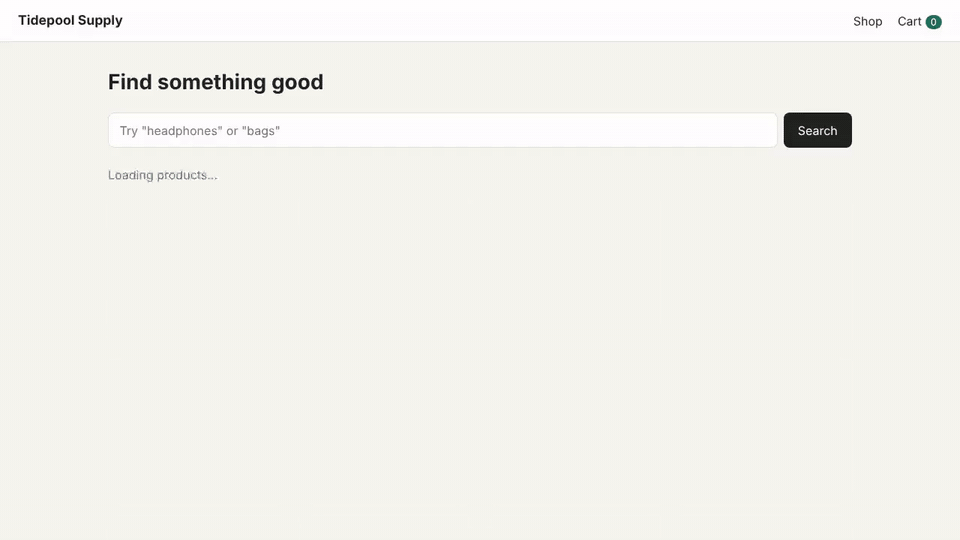

# Playwright E-commerce Checkout Tests

[](https://github.com/antonada/playwright-ecommerce-checkout/actions/workflows/playwright.yml)


End-to-end test suite for a small online shop. It covers product search, the cart, checkout form validation, and what happens when the backend fails: 500s, timeouts, dropped connections, rate limits and broken responses.

The shop itself lives in this repo too (`app/`). I wanted full control over the data and the API, so the tests are stable and every failure case can be reproduced on demand, which isn't really possible against a public demo site.



The clip shows four tests in a slowed-down run: the full purchase flow, a search that hits a 500 and recovers on retry, the empty form validation, and an order that fails with a 503 while keeping everything the customer typed. Full quality version: [docs/media/demo.mp4](docs/media/demo.mp4).

## What's covered

| Area                | Tests | Highlights                                                                                           |
| ------------------- | ----: | ---------------------------------------------------------------------------------------------------- |
| Search              |     9 | Partial and case-insensitive matches, empty results, XSS in the query, state kept in the URL         |
| Cart                |     9 | Totals and shipping math, $100 free shipping boundary, quantity limits, persistence on reload        |
| Checkout validation |    20 | All required fields, 14 data-driven invalid inputs, focus handling, expiry date boundaries           |
| API failures        |    15 | 500/503/429, network errors, invalid JSON, timeouts via `page.clock`, stale responses, double submit |
| End to end          |     1 | Search to order confirmation, including a check of the request body sent to the API                  |
| API (no browser)    |    11 | Response shape, server-side validation, prices taken from the catalog instead of the client          |

UI tests run in Chromium, Firefox, WebKit and a mobile Chrome viewport (Pixel 7), so a full run is 227 tests. Every case is listed in the [test plan](docs/TEST_PLAN.md), and the latest results are in the [test report](docs/TEST_REPORT.md).

## Running it

You need Node.js 20 or newer.

```bash
npm ci
npx playwright install --with-deps
npm test
```

Playwright starts the shop on port 3000 automatically. If you want to click around yourself, run `npm start` and open http://localhost:3000.

Some other useful commands:

```bash
npm run test:chromium     # API tests + Chromium only, quickest full check
npm run test:smoke        # just the @smoke tests
npm run test:api-errors   # just the backend failure scenarios
npm run test:ui           # Playwright UI mode
npm run report            # open the last HTML report
npm run demo:record       # re-record the GIF and MP4 in docs/media (needs ffmpeg)
```

## Project layout

```
app/                 the demo shop (Express API + plain HTML/JS frontend)
  data/              fixed product catalog
  public/js/         frontend code; validation.js is shared with the server
pages/               page objects
fixtures/            custom fixtures and test data
utils/               API mocking helpers, money formatting
tests/               UI specs
tests/api/           API specs that run without a browser
docs/                test plan, test report, demo media
```

## How backend failures are simulated

Failures are injected in the browser with `page.route()`, so the real server never needs a special "broken" mode. The helpers in [`utils/api-mocks.ts`](utils/api-mocks.ts) keep the specs short:

```ts
test('shows an error on 500 and recovers after "Try again"', async ({ shopPage, page }) => {
  const calls = await failFirstRequests(page, PRODUCTS_API, 500);
  await shopPage.goto();

  await expect(shopPage.errorBanner).toContainText("Couldn't load products.");

  await shopPage.retryButton.click();

  await expect(shopPage.productCards).not.toHaveCount(0);
  expect(calls()).toBe(2);
});
```

The app aborts requests after 8 seconds. Instead of actually waiting, the timeout tests install Playwright's fake clock and jump forward:

```ts
await page.clock.install();
await mockNoResponse(page, PRODUCTS_API);
await shopPage.goto();

await page.clock.runFor(8_500);
await expect(shopPage.errorBanner).toContainText('The store is taking too long to respond.');
```

## Design notes

Locators go role and label first (`getByRole`, `getByLabel`). `data-testid` is only used where there's nothing better to grab, like the cart badge or line totals. Nice side effect: if a label goes missing, tests fail, so the app stays reasonably accessible.

Page objects are thin. They hold locators and a few actions, and assertions stay in the specs, so you can read a test and see what it checks.

Cart and checkout tests put items straight into `localStorage` through a fixture instead of clicking through the shop every time. Only the end-to-end test goes the long way.

The checkout rules live in one module that both the browser and the server import. The API tests check that the server enforces them too, since client-side checks are easy to bypass.

There are no sleeps anywhere. Everything waits on web-first assertions, and the suite passes with `--repeat-each=3`.

## CI

[GitHub Actions](.github/workflows/playwright.yml) runs lint and the full suite on every push and pull request. The HTML report (with traces for retried tests) and JUnit XML are uploaded as artifacts, and the report from `main` is published to GitHub Pages:

https://antonada.github.io/playwright-ecommerce-checkout/

## Ideas for later

- Visual regression snapshots for the main pages
- Accessibility checks with `@axe-core/playwright`
- Sharding the run across several CI jobs once it gets slower

## License

MIT
